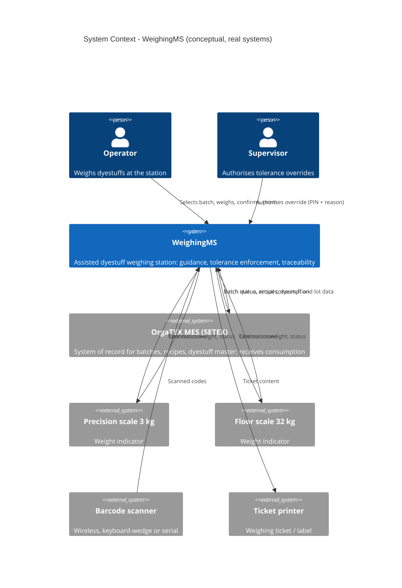
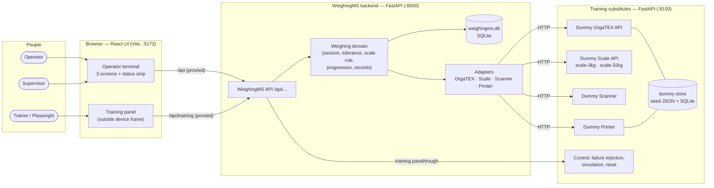

# Assisted Dyestuff Weighing Station - System Context

## System Overview

**WeighingMS** is the weighing-station application. It receives batches and recipes from **OrgaTEX**, guides the **operator** through weighing each component on the right **scale**, takes batch input from a **barcode scanner**, records every weighing, writes actual consumption back to OrgaTEX and prints a ticket on the **ticket printer**. A **supervisor** authorises tolerance exceptions.

Two views of the same context are given:
1. **Conceptual context** — the real systems and devices WeighingMS is designed for.
2. **Training context** — what actually runs in this build: each real system/device is replaced by a **training substitute** (Dummy API) with the same responsibility at the boundary. WeighingMS code reaches both through the same adapters, so a dummy can later be swapped for the real thing.

## Actors

| Actor | Type | Description | Interacts via |
|-------|------|-------------|---------------|
| **Operator** | Human | Weighing operator at the 15" touch terminal; selects batches, weighs, confirms, re-tares, quits, prints | WeighingMS UI (touch, keyboard F-keys, scanner) |
| **Supervisor** | Human | Authorises out-of-tolerance confirmation with PIN + reason | WeighingMS UI (override dialog) |
| **Trainer / test runner** | Human / automated (training only) | Drives simulations, injects failures, resets data | Training panel, Dummy control endpoints, Playwright |

## Context Diagram — Conceptual (real systems)

## Context Diagram — Training build (what runs)

`npm run dev` starts all three processes. The browser only talks to the WeighingMS API (through the Vite proxy); it never calls a dummy directly.

## Real systems vs training substitutes

| Real conceptual system | Training substitute (this build) | Boundary contract | Where the difference is absorbed |
|------------------------|----------------------------------|-------------------|----------------------------------|
| OrgaTEX MES (SETEX) | **Dummy OrgaTEX API** — `GET /api/batches`, `GET /api/batches/{id}`, `GET /api/batches/{id}/recipe`, `POST /api/batches/{id}/consumption`, `GET /api/batches/{id}/consumption`, `PATCH /api/batches/{id}/status` | Workbook training contract — **not** the real interface (UQ-01, UQ-02) | OrgaTEX adapter (Brief IR-07) |
| Precision scale 3 kg + indicator | **Dummy Scale API** `scale-3kg` | `GET /api/scales`, `GET /api/scales/{id}/status`, `GET /api/scales/{id}/weight`, `POST /api/scales/{id}/tare` | Scale adapter (protocol unknown, UQ-04) |
| Floor scale 32 kg + indicator | **Dummy Scale API** `scale-32kg` | same | Scale adapter |
| Barcode scanner (keyboard-wedge/serial) | **Dummy Scanner** — `POST /api/scanner/scans`, `GET /api/scanner/scans?after=`, `GET /api/scanner/status`; plus keyboard-wedge entry in the UI | Training contract | Scanner adapter |
| Ticket printer | **Dummy Printer** — `POST /api/tickets`, `GET /api/tickets`, `GET /api/tickets/{id}`, `GET /api/printer/status` | Training contract (Workbook minimum `POST /api/tickets`) | Printer adapter |
| — | **Dummy control** — `/api/control/...` (availability toggles, simulation profiles, reset) | Training-only, no real counterpart | Training panel / tests only |

## External Integrations

- **OrgaTEX (Dummy OrgaTEX)**: source of batch queue, batch header, recipe with components, dyestuff and lot data; recipient of batch status and actual consumption. REST/JSON.
- **Scales (Dummy Scale)**: continuous net/gross weight, status, calibration; tare command. REST/JSON polled ≥ 5 Hz (training stand-in for a continuous serial/Ethernet stream).
- **Scanner (Dummy Scanner)**: scanned batch codes, delivered in order once. REST/JSON polling + keyboard-wedge input.
- **Printer (Dummy Printer)**: ticket submission and status. REST/JSON.

## Data Flows

### Inbound (into WeighingMS)

| From | Data | Format | Validation |
|------|------|--------|------------|
| OrgaTEX | Batch queue: batchId, order, machine, fabric, fabric weight, shade, component count, status, released time | JSON | Schema-validated; unknown statuses treated as non-selectable |
| OrgaTEX | Recipe: recipeId, shade, version, components (sequence, dyestuff code/name/colour, target qty as decimal string, unit g/kg, tolerance, lot) | JSON | Decimals parsed exactly; units restricted to g/kg; sequence unique |
| Scale | Reading: gross, net, unit, stable flag, timestamp; status: up/down, calibration due | JSON | Reading older than 2 s or status down → scale unavailable |
| Scanner | Scan: sequence number, code, timestamp | JSON / keyboard text | Code matched against queue |
| Operator | Selections, confirm, re-tare, quit, operator badge | UI events | Backend re-checks state and tolerance |
| Supervisor | PIN, reason | UI form | PIN verified against hash; reason mandatory |

### Outbound (from WeighingMS)

| To | Data | Format | Guarantees |
|----|------|--------|------------|
| OrgaTEX | Batch status WEIGHING / WEIGHED | JSON PATCH | Best effort; failures logged |
| OrgaTEX | Consumption: batch, session ID (idempotency key), completed at, per component: code, lot, target, actual, unit, scale, operator, confirmed at | JSON POST | **Idempotent** (no duplicate on retry); PENDING + retry if unavailable |
| Scale | Tare command | JSON POST | Confirmed by a subsequent net ≈ 0 reading |
| Printer | Ticket: header, batch fields, operator, date, component lines, result line, barcode value, reprint flag | JSON POST | Ticket ID returned; failure surfaced to operator |
| Operator UI | Batch queue, recipe, live evaluation (weight, zone, remaining, canConfirm), summary, ticket preview, device status | JSON | Decimal strings with unit |

## Ownership

| Data | Owner (system of record) | WeighingMS role |
|------|--------------------------|-----------------|
| Batch header, status | OrgaTEX | Read; write weighing status only |
| Recipe, components, tolerances | OrgaTEX | Read-only; snapshot per session |
| Dyestuff master, lots | OrgaTEX | Read-only |
| Container master (ID, type, tare) | WeighingMS | Master |
| Scale configuration (class, threshold, default tolerance rule) | WeighingMS | Master (config file) |
| Operators, supervisors | WeighingMS (training) | Master |
| Weighing sessions, records, overrides, audit events, sync status | WeighingMS | Master |
| Actual consumption | OrgaTEX (after posting) | Produces and posts |
| Printed tickets | Printer (physical) / Dummy Printer store | Produces |

## Integration Boundaries

1. **Browser ↔ WeighingMS API** — the only interface the UI uses. Business rules live behind it.
2. **WeighingMS domain ↔ ports** — the domain depends only on port interfaces (`OrgatexPort`, `ScalePort`, `ScannerPort`, `PrinterPort`).
3. **Adapters ↔ external systems (dummies)** — one adapter per external system, HTTP only. Base URLs from configuration. No WeighingMS code imports dummy code.
4. **Dummy service** — separate process and separate data store; replaceable by real integrations without changing WeighingMS's database or domain.

## Failure Boundaries

| Failure | Detected by | Contained where | Operator sees | Safe outcome |
|---------|-------------|-----------------|---------------|--------------|
| OrgaTEX unavailable — loading queue/recipe | OrgaTEX adapter (timeout/503) | WeighingMS API returns 503 `ORGATEX_UNAVAILABLE` | "OrgaTEX unavailable — Retry"; strip ORGATEX red | No batch starts on missing data |
| OrgaTEX unavailable — during weighing | — (recipe snapshot held) | Session uses snapshot | Strip ORGATEX red; weighing continues | Weighing in progress unaffected (BR-16) |
| OrgaTEX unavailable — at completion | OrgaTEX adapter | Session completed locally, write-back PENDING | "Written to OrgaTEX · PENDING — Retry" | No loss, no duplicate on retry |
| Selected scale unavailable / stale reading | Scale adapter (503 / reading > 2 s old) | Live evaluation `scaleAvailable=false` | "—", "SCALE OFFLINE — CHECK CONNECTION"; strip red | Confirm disabled; backend rejects confirm |
| Scale calibration expired | Scale status | Domain rule | Strip "CAL EXPIRED" | Confirm blocked on that scale |
| Scanner unavailable | Scanner adapter | Scan polling stops | Scan prompt shows unavailable; strip red | Touch selection still works |
| Printer unavailable | Printer adapter | Ticket API returns 503 `PRINTER_UNAVAILABLE` | "Printer unavailable — try again" | Batch completion unaffected; print retry |
| WeighingMS backend down | UI API client | UI | "Station service unavailable" banner | Nothing confirmed without backend |
| Database write failure on confirm | Persistence | Transaction rolled back | Error message; component stays active | No half-written record |

## High-Level Constraints

- Training build: the four external systems are dummies; their contracts are training contracts, not real OrgaTEX or device specifications.
- Dummies run as a separate service (`:8100`) reached only over HTTP; WeighingMS API on `:8000`; UI on Vite dev server (`:5173`) with `/api` proxied; all started by `npm run dev`.
- Single station, single site; English UI.
- OrgaTEX remains the system of record (Brief C-01, C-02); no dispensing-machine control (C-03).

## Key NFR Goals

- Live weight shown within 200 ms of change; recipe within 3 s of selection.
- No confirmation outside tolerance without an audited override; backend re-reads weight at confirm.
- Confirmed records durable before acknowledgement and immutable.
- Write-back idempotent; failures visible and retryable.
- Deterministic, failure-injectable dummies so every boundary above is covered by automated tests.
